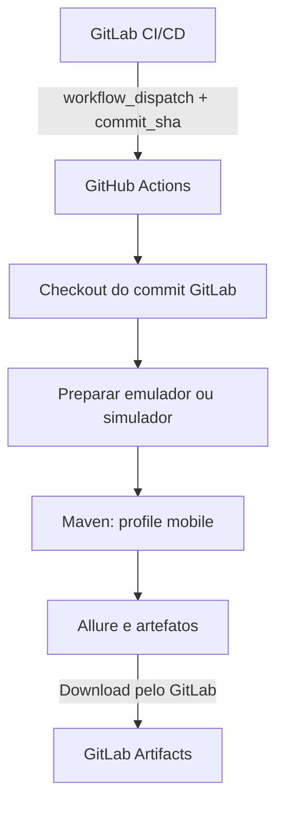

# Desafio QA — Executor Mobile (Android e iOS)

Repositório auxiliar do desafio técnico de automação de testes da Verity. Utiliza GitHub Actions para executar os testes Appium em emuladores Android e simuladores iOS hospedados na nuvem.

O código Java, os cenários, o Maven, a pipeline principal e as evidências de entrega estão no **[repositório GitLab — desafio-automacao-qa](https://gitlab.com/ckenans/desafio-automacao-qa)**. Este repositório não mantém uma segunda cópia do código de testes e não executa a suíte de API.

## 1. Estrutura

```text
.github/workflows/
├── android-tests.yml
└── ios-tests.yml
README.md
```

| Workflow | Responsabilidade |
|---|---|
| `android-tests.yml` | Preparar Ubuntu, Android Emulator, Appium e UiAutomator2 |
| `ios-tests.yml` | Preparar macOS, Xcode, iOS Simulator, Appium e XCUITest |

## 2. Integração com o GitLab



O GitLab dispara o workflow correspondente via API REST do GitHub, informando o SHA do commit em `commit_sha`. O workflow consulta o repositório privado do GitLab com um Deploy Token de leitura, faz checkout do commit e valida o SHA. Em seguida, prepara o ambiente, baixa o Native Demo App e executa o profile Maven `mobile`.

O GitLab acompanha o ID da execução até sua conclusão e recupera o artefato correspondente. O resultado do GitHub é propagado ao job GitLab; evidências disponíveis são preservadas mesmo em caso de falha.

## 3. Ambientes de execução

| Componente | Android | iOS |
|---|---|---|
| Runner | `ubuntu-24.04` | `macos-15` |
| Dispositivo de referência | Pixel 2, x86_64 | iPhone 16, ARM64 |
| Sistema validado | Android 11 / API 30 | iOS 18.5 |
| Driver Appium | UiAutomator2 4.2.9 | XCUITest 9.10.5 |
| Ferramentas | Android SDK, ADB, KVM | Xcode 16.4, simctl |
| Java / Node.js | 17 / 22 | 17 / 22 |
| Appium Server | 2.19.0 | 2.19.0 |
| Relatório | Allure Single File | Allure Single File |

O ambiente Android foi ajustado para reduzir o uso de disco e estabilizar a interface do sistema: limpeza de ferramentas não utilizadas, perfil de menor resolução, partição de dados de 4 GB, 3 GB de RAM e espera após o boot. Os logs incluem diagnóstico de ANR. No iOS, o binário destinado ao simulador é verificado antes dos testes.

A versão de referência do Native Demo App é v1.0.8; o binário efetivamente utilizado é definido no respectivo workflow. O log da execução Android de referência confirma API 30, mas não identifica a versão exata do APK. Há uma divergência de capability solicitada (14) e versão efetiva (11) nos logs; para diagnóstico, use a versão efetiva do dispositivo.

## 4. Configuração dos acessos

### GitHub — acesso de leitura ao GitLab

No projeto GitLab, crie um Deploy Token com escopo `read_repository` em **Settings → Repository → Deploy tokens**. Cadastre o username e token correspondentes no GitHub, em **Settings → Secrets and variables → Actions**:

| Tipo | Nome | Valor |
|---|---|---|
| Secret | `GITLAB_USERNAME` | Username do Deploy Token |
| Secret | `GITLAB_TOKEN` | Valor do Deploy Token |
| Variable | `GITLAB_REPOSITORY` | `https://gitlab.com/ckenans/desafio-automacao-qa.git` |

O checkout utiliza `GIT_ASKPASS` para autenticação sem interação. Não coloque credenciais em URLs, código ou logs.

### GitLab — disparo dos workflows

Crie um Fine-grained Personal Access Token no GitHub restrito a este repositório, com **Actions: Read and write**. No projeto GitLab, em **Settings → CI/CD → Variables**, configure:

| Nome | Valor / configuração |
|---|---|
| `GITHUB_OWNER` | `ckenans` |
| `GITHUB_REPOSITORY` | `verity-qa-ios` |
| `GITHUB_TOKEN` | Token GitHub, protegido e mascarado/oculto |

O GitLab utiliza as variáveis protegidas apenas nas execuções autorizadas. As regras de push/MR e a retenção final dos artefatos são gerenciadas no GitLab. Restrinja a edição dos workflows e das branches que podem acessar credenciais a colaboradores autorizados.

## 5. Como executar

A forma normal é utilizar a pipeline do GitLab. Não é necessário disparar manualmente os workflows do GitHub para cada alteração.

Para diagnóstico manual:

1. Acesse **Actions** neste repositório.
2. Selecione **Mobile Android** ou **Mobile iOS**.
3. Clique em **Run workflow**, selecione a branch `main` e informe o SHA completo de um commit existente e acessível no GitLab (`commit_sha`).
4. Acompanhe a execução e consulte os artefatos em **Summary**.

O disparo manual direto no GitHub não cria um job no GitLab nem transfere automaticamente as evidências para ele. Para centralizar o resultado, utilize a pipeline principal.

## 6. Evidências e resultados validados

Execução de referência: [GitLab Pipeline 3114252884](https://gitlab.com/ckenans/desafio-automacao-qa/-/pipelines/3114252884), de 25/11/2026.

| Plataforma | Execução GitHub | Testes | Screenshots |
|---|---|---:|---:|
| Android 11 | [Run 45636771051](https://github.com/ckenans/verity-qa-ios/actions/runs/45636771051) | 10/10 aprovados | 64 |
| iOS 18.5 | [Run 45636773641](https://github.com/ckenans/verity-qa-ios/actions/runs/45636773641) | 10/10 aprovados | 69 |

Ambas as execuções utilizaram o commit GitLab `311f2cc41cc5e18ba1d41b1efc17b961149e6796` e retornaram `success`, sem falhas, erros ou testes ignorados. Foram gerados 113 screenshots por passo e 20 screenshots finais (133 no total). A execução Android não apresentou registros de ANR desde o boot, conforme `android-environment.log`.

Os workflows publicam `evidencias-android` e `evidencias-ios`, contendo os arquivos disponíveis:

- `target/site/allure-maven-plugin/index.html`: Allure Single File.
- `target/allure-results/`: resultados e anexos.
- `target/surefire-reports/`: relatórios XML/TXT.
- `target/screenshots/`: screenshots por passo e finais.
- `appium.log` e logs de testes e ambiente da plataforma.

A retenção no GitHub é configurada nos workflows (7 dias nas versões de referência); o GitLab recupera e conserva os artefatos por 90 dias conforme a pipeline principal. Abra o HTML após extrair o ZIP. O avaliador pode consultar os relatórios pelo GitLab, sem precisar de acesso ao GitHub.

## 7. Observações

- As execuções utilizam dispositivos virtuais, não aparelhos físicos; BrowserStack não é necessário.
- O runner macOS permite testar iOS sem possuir um equipamento Apple.
- O Android foi validado com API 30 após ajustes de estabilidade do ambiente.
- Os logs podem incluir dados fictícios de preenchimento; não utilize credenciais reais nos testes.
- A disponibilidade dos runners, runtimes e a franquia de minutos dependem dos serviços hospedados. Alterações nos workflows devem ser validadas e mantidas compatíveis com o contrato de integração (`commit_sha`, nomes de artefatos e caminhos de saída).

A documentação dos cenários, a execução local, o escopo de API e suas limitações estão no [README principal do GitLab](https://gitlab.com/ckenans/desafio-automacao-qa).
